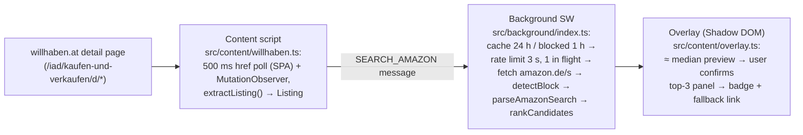

# Repository Guidelines

## Project Overview

**Willhaben Gewin** — Chrome extension (Manifest V3) that overlays `willhaben.at` listing pages with the new-price comparison from Amazon.de: viewing a used €380 iPhone shows new €429.65 → overpay +€49.65 (+13%).

**Status: MVP built (v1), e2e-verified on a live listing 2026-11-01.** Working: content-script extraction on willhaben detail pages, background Amazon search (24 h cache + 3 s rate limit), title matching with explicit user confirmation (top-3 panel), Shadow-DOM badge with fallback link, DE/EN/RU strings, vitest suite (24 tests on live-HTML fixtures), headless Chrome e2e via CDP.

- v1 direction is **Willhaben → Amazon** (user decision). The original Amazon → Willhaben idea is deferred: spec in `ideas/amazon-to-willhaben/IDEA.md`, trilingual mirror in `ideas/amazon-to-willhaben/README.md`.
- Root `README.md` is the current spec, trilingual mirror (EN → `## Deutsch` → `## Русский`); all 5 roadmap items are checked (verified 2026-11-01).
- LICENSE is MIT © 2026 zaharenok; remote `github.com/zaharenok/willhaben-gewin`.

When reading this doc: **implemented** = file on disk; **planned** = prose in `ideas/amazon-to-willhaben/` only.

## Architecture & Data Flow

Implemented v1 flow (Willhaben → Amazon):



Constraints and decisions:

- **No backend** — everything runs in the browser (MVP constraint). Server-side is an explicit non-goal.
- **Data channel (decided)**: background worker fetches `amazon.de/s?k=…` directly and parses with pure string ops — MV3 service workers have no `DOMParser`, so `src/lib/parse-amazon.ts` is deliberately DOM-free; the live fixture pins the markup contract. **Plan B is implemented and e2e-verified**: when the worker's fetch is blocked/fails, it opens a background tab on the search URL and relays `PARSE_SEARCH` to `src/content/amazon.ts` (manifest content script on `https://www.amazon.de/s*`), which answers parsed items from the real DOM (readiness window 25 s — idle injection on amazon takes seconds); the worker then closes the tab. Only if the tab path also fails does the badge degrade to a direct search link. No `scripting` permission is needed (manifest-declared content script).
- **Risks**: markup changes break extraction/parsing (fixture tests fail first); Amazon may block (rate limit 3 s + 1 h blocked-cache + fallback link); used-item matching is imprecise → the badge shows a **min–median range**, the median candidate is only a `≈` preview, and the user must confirm the actual product.
- **Scope**: `amazon.de` + `willhaben.at` only (Austria). Other marketplaces later.
- **Non-goals (for now)**: auto-buying, notifications, accounts, server-side backend, Amazon account integration. Do not add these unprompted.

## Key Directories

```
.
├── README.md               # Trilingual (EN/DE/RU) spec: Willhaben → Amazon, roadmap (all checked)
├── manifest.json            # MV3 manifest; TS entry paths (plugin requirement), page patterns
├── package.json / pnpm-lock.yaml / pnpm-workspace.yaml
├── tsconfig.json            # ES2024, strict, bundler resolution
├── vite.config.ts           # plugins: [webExtension()]
├── vitest.config.ts         # jsdom environment, tests/**/*.test.ts
├── src/
│   ├── lib/                 # Pure logic, no browser APIs: extract-willhaben (SELECTORS),
│   │                        # parse-amazon (DOM-free string parsing), match, savings,
│   │                        # i18n, cache (TTL), parse-eur, protocol (message types)
│   ├── background/index.ts  # MV3 service worker: SEARCH_AMAZON handler,
│   │                        # cache + rate limit + fetch/parse/rank pipeline
│   └── content/
│       ├── willhaben.ts     # SPA navigation watcher → extract → message → overlay
│       ├── amazon.ts        # Plan B relay: answers PARSE_SEARCH with parsed items
│       ├── overlay.ts       # Shadow-DOM badge, states: loading/preview/confirmed/fallback
│       └── overlay.css      # injected raw into the shadow root
├── tests/                   # vitest unit tests + tests/fixtures/*.html (live captures)
├── ideas/amazon-to-willhaben/  # Deferred original idea (spec + trilingual mirror)
├── LICENSE                  # MIT
├── .gitignore               # node_modules/, dist/, .env, .DS_Store, *.zip
├── dist/                    # Build output (gitignored) — load unpacked at chrome://extensions
└── .nodeterm/project.json   # NodeTerm terminal-workspace UI state — NOT project config
```

- `.nodeterm/project.json` is terminal-app session state (untracked). Never read it for build/test settings; don't commit it.

## Development Commands

```bash
pnpm install        # deps (pnpm 11; lockfile committed)
pnpm dev            # vite dev — loads the extension into a dev browser
pnpm build          # vite build → dist/ (load unpacked at chrome://extensions)
pnpm test           # vitest run (24 unit tests, jsdom + live-HTML fixtures)
pnpm exec tsc --noEmit   # typecheck (no emit script configured)
```

All scripts are defined in `package.json`; do not invent `make`/`npm run …` alternatives.

## Code Conventions & Common Patterns

- **Stack (chosen)**: TypeScript (ES2024, `strict`) + Vite 8 + `vite-plugin-web-extension` (v4) — root `manifest.json` references TS entry files directly; no CRXJS.
- **MV3 patterns**: cross-origin Amazon queries happen only in the background service worker; the worker has **no DOM** (`DOMParser` is unavailable) — HTML parsing is pure string ops in `src/lib/parse-amazon.ts`.
- **Code layout**:
  - pure logic lives in `src/lib/` with no browser-API access (cache takes an injected storage adapter) so vitest can test it directly;
  - platform selectors live in exactly one place each: willhaben → `SELECTORS` in `src/lib/extract-willhaben.ts`, amazon → constants in `src/lib/parse-amazon.ts`; never scatter selectors — change them together with their fixture;
  - the overlay is a `div[data-whg-badge]` with a **Shadow DOM** root (`mode: "open"` so e2e can read it); styles ship as `overlay.css` imported `?raw`;
  - message shapes are typed once in `src/lib/protocol.ts` (`SEARCH_AMAZON` → `SearchResponse`).
- **Product invariants to preserve in any code**:
  - fuzzy match always ends in explicit **user confirmation** (MVP) — the median candidate renders only as an unconfirmed `≈` preview; never auto-decide the listing;
  - prices render as a **min–median range** with absolute (€) and percent savings;
  - every lookup path ends in a visible badge state — including a fallback search link when Amazon blocks;
  - in-browser only — no network backend.
- **Doc conventions**: `README.md` mirrors all three languages in order EN → DE → RU, split by `## Deutsch` / `## Русский` headings — any README edit must land in all three sections. `ideas/amazon-to-willhaben/IDEA.md` stays Russian (English tech loanwords like "content script", "fuzzy-match", "MVP" are normal). Roadmap items use `- [ ]` checkboxes (checked when verified).

## Important Files

| Path | Role |
|---|---|
| `manifest.json` | MV3 manifest: `content_scripts[0].matches` (`https://www.willhaben.at/*` — broad because willhaben is an SPA), `host_permissions`, TS entry paths (plugin requirement) — the one place for page patterns/permissions |
| `src/background/index.ts` | `SEARCH_AMAZON` handler: cache → rate limit (3 s, serialized) → direct fetch → hidden-tab fallback → parse/rank — the choke point for Amazon blocks |
| `src/content/willhaben.ts` | 500 ms `location.href` poll + MutationObserver; wrong detection = no badge |
| `src/content/amazon.ts` | Plan B relay on `amazon.de/s*` — parses the tab's DOM on worker request; idle otherwise |
| `src/content/overlay.ts` | Shadow-DOM badge + top-3 confirm panel + fallback link state |
| `src/lib/extract-willhaben.ts` | `SELECTORS` — single source of truth for willhaben selectors; change together with the fixture |
| `src/lib/parse-amazon.ts` | DOM-free amazon search parser + `detectBlock`; change together with the fixture |
| `src/lib/protocol.ts` | Message contract between content script and background worker |
| `tests/fixtures/*.html` | Live captures (`willhaben-ad.html`, `amazon-search.html`); parser tests fail first when markup rots |
| `README.md` | Current trilingual spec (Willhaben → Amazon), roadmap (all checked), non-goals |
| `ideas/amazon-to-willhaben/IDEA.md` | Deferred original Amazon → Willhaben idea (Russian) — do not confuse with v1 |
| `.gitignore` | `node_modules/`, `dist/`, `.env`, `.DS_Store`, `*.zip` (extension packages) |
| `LICENSE` | MIT |
| `.nodeterm/project.json` | NodeTerm session state (one terminal pane); untracked; not a build config |

Entry points: `src/background/index.ts` (service worker) and `src/content/willhaben.ts` (content script) — wired via `manifest.json`, bundled by Vite into `dist/`.

## Runtime/Tooling Preferences

- **Target runtime**: Chrome, Manifest V3. No cross-browser support planned.
- **Language**: TypeScript, `strict`, `target/lib ES2024` (`Promise.withResolvers`); zero JSX.
- **Toolchain (chosen)**: pnpm 11 (lockfile committed, `pnpm-workspace.yaml` carries `allowBuilds: {spawn-sync: false}` — pnpm 11 rejects the legacy `pnpm.ignoredBuiltDependencies` package.json key), Vite 8 + `vite-plugin-web-extension` 4, vitest 5 + jsdom, `webextension-polyfill` 0.12. No linter/formatter/CI yet — don't add unprompted.
- Manage dependencies inside this project only (no global installs) — this repo is a folder in a multi-project hub where each project owns its deps.

## Testing & QA

- **Unit**: `pnpm test` — vitest 5, jsdom environment, `tests/*.test.ts` (24 tests). Contract: fixtures are *live captures* (`tests/fixtures/willhaben-ad.html`, `amazon-search.html`) — parser/matcher tests fail first when either site changes markup; re-capture the fixture and update `SELECTORS`/`parse-amazon` together.
- **Typecheck**: `pnpm exec tsc --noEmit` (build itself is esbuild-only, no type checking).
- **Build gate**: `pnpm build` must emit `dist/manifest.json` + both entry bundles.
- **Headless e2e** (per skill `mv3-extension-headless-verify`): launch `~/Library/Caches/ms-playwright/chromium-*/chrome-mac-arm64/Google Chrome for Testing.app/Contents/MacOS/Google Chrome for Testing --headless=new --remote-debugging-port=9333 --user-data-dir=/tmp/whg-profile --load-extension=<repo>/dist`, attach via `browser.open({app:{cdp_url:"http://127.0.0.1:9333"}})`, open a live willhaben.at listing, poll from the outside for `[data-whg-badge]` (evaluate = isolated world: DOM reads only), accept badge text matching `/€\s?\d/` **or** a rendered fallback link when Amazon blocks. Cleanup: `pkill -f remote-debugging-port=9333; rm -rf /tmp/whg-profile`.
- **Last verified 2026-11-01**: unit 24/24, `tsc --noEmit` clean, `pnpm build` clean, live e2e — badge rendered `≈ New on Amazon: ab € 39,31 · Overpay −€ 299,34 (−79%)`, top-3 confirm → `+€ 49,65 (+13%)`, selection survived reload (cache hit). Plan B e2e: worker `fetch` broken via CDP → `direct path failed, trying hidden-tab fallback` → relay loaded in the amazon tab → `hidden tab parsed 16 items` at ~8 s → badge with full prices; tab closed itself.
